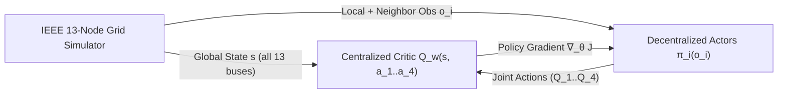
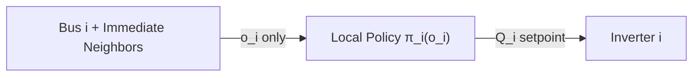

# Reinforcement Learning Knowledge Guide for Decentralized Voltage Control

**Tailored for:** Xavier Gonzalez Torres (DREAM Master's Thesis)  

---

## 0. Bridge from Control Theory to Reinforcement Learning

Because you already have a strong background in **LQR, Model Predictive Control (MPC), and state-space feedback**, the fastest way to master Reinforcement Learning (RL) is to view it as **data-driven optimal control**. Almost every core RL concept maps directly to classical optimal control:

| Optimal Control Concept (LQR / MPC) | Reinforcement Learning Equivalent | Meaning in This Voltage Control Thesis |
| :--- | :--- | :--- |
| System state $x_t$ | State $s_t \in \mathcal{S}$ | Bus voltages, line flows, exogenous load & PV active power $P_{\mathrm{ref}}$ |
| Measurement output $y_t = Cx_t$ | Local observation $o_t^i \in \mathcal{O}^i$ | Local bus voltage + immediate neighbor voltages (passive nodes unobserved) |
| Control input $u_t$ | Action $a_t \in \mathcal{A}$ | Inverter reactive power setpoint $Q_i(t)$ |
| Plant dynamics $\dot{x} = f(x,u)$ | Transition probability $P(s_{t+1} \mid s_t, a_t)$ | AC power flow + feeder/load dynamics inside Simulink/OpenDSS/pandapower |
| Stage cost $\ell(x_t, u_t)$ | Negative reward $-r(s_t, a_t)$ | Voltage deviation penalty + reactive power effort / network loss |
| Infinite-horizon cost $J = \sum \gamma^t \ell$ | Return $G_t = \sum_{k=0}^\infty \gamma^k r_{t+k}$ | Cumulative discounted grid voltage quality over an episode |
| Optimal cost-to-go $J^*(x)$ (HJB / Riccati) | Optimal Value Function $-V^*(s)$ / $-Q^*(s,a)$ | Expected future cumulative reward from state $s$ (or state-action $(s,a)$) |
| Feedback control law $u = -Kx$ or MPC | Policy $\pi_\theta(a \mid o)$ or $a = \pi_\theta(o)$ | Neural network (or compact function) mapping observations $o_i$ to $Q_i$ |
| Input constraints $u \in \mathcal{U}$ | Bounded action space / safety projection | Inverter apparent power capability: $S_i$|Q_i(t)| \le \sqrt{S_{\max, i}^2 - P_{\mathrm{ref}, i}(t)^2}$ |
| State constraints $x \in \mathcal{X}$ | Constrained MDP / Safety Filter | Keeping all active & passive bus voltages within $[0.95, 1.05]\text{ p.u.}$ |

> [!TIP]
> **Key Conceptual Shift:** In MPC/LQR, you solve an optimization problem using an explicit analytical model $f(x,u)$. In **model-free RL**, the power grid simulator acts as a black-box environment—the agent learns an explicit feedback policy $\pi_\theta(o)$ offline by trial-and-error interaction, enabling **millisecond online execution** using only local measurements (`[4]` Table 1).

---

## 1. Mathematical Formulation: MDP & Dec-POMDP

### 1.1 Single-Agent MDP (End-of-Year Base Model)
A **Markov Decision Process (MDP)** is defined by the tuple $(\mathcal{S}, \mathcal{A}, P, r, \gamma)$:
* **State ($s_t \in \mathcal{S}$):** Full measurable grid state at step $t$ (e.g., bus voltage magnitudes $v_k$, active/reactive power flows, current inverter active power $P_{\mathrm{ref}}$).
* **Action ($a_t \in \mathcal{A}$):** Continuous reactive power setpoint $Q(t) \in [-Q_{\max}(t), +Q_{\max}(t)]$.
* **Transition ($P(s_{t+1} \mid s_t, a_t)$):** Driven by the AC power-flow equations and exogenous disturbances (load events, solar irradiance).
* **Reward ($r_t$):** Scalar feedback signal measuring voltage quality and control effort (see Section 5.2).
* **Discount factor ($\gamma \in [0, 1)$):** Balances immediate voltage correction vs. future trajectory stability. For quasi-static voltage control, $\gamma \approx 0.9\text{--}0.99$ (or $\gamma \approx 0\text{--}0.5$ if each step quickly reaches steady state).

### 1.2 Multi-Agent Dec-POMDP (Target IEEE 13-Node Grid)
When scaling to the 4 distributed inverters (`Bus 634`, `Bus 672`, `Bus 675`, `Bus 680` in [Schulte et al., 2026]), each agent $i \in \{1, 2, 3, 4\}$ only sees a **partial local observation** $o_t^i$:
$$o_t^i = \big(v_t^i,\ \{v_t^j\}_{j \in \mathcal{N}_i},\ P_{\mathrm{ref}, t}^i,\ Q_{t-1}^i\big)$$
where $\mathcal{N}_i$ is the set of immediate electrical neighbors of bus $i$. Because passive load buses are not directly observed by the agents and all 4 agents share a common grid-wide voltage objective, the problem is a **Cooperative Decentralized Partially Observable MDP (Dec-POMDP)**.

### 1.3 Value Functions & Bellman Optimality
Every actor-critic RL algorithm relies on estimating one or both of the following:
* **State-Value Function:** Expected return starting at $s$ and following policy $\pi$:
  $$V^\pi(s) = \mathbb{E}_\pi\left[\sum_{k=0}^\infty \gamma^k r_{t+k} \;\middle|\; s_t = s\right]$$
* **Action-Value Function ($Q$-function):** Expected return after taking action $a$ in state $s$, then following $\pi$:
  $$Q^\pi(s, a) = \mathbb{E}_\pi\left[\sum_{k=0}^\infty \gamma^k r_{t+k} \;\middle|\; s_t = s, a_t = a\right]$$
* **Bellman Optimality Equation** (the RL equivalent of the discrete-time Hamilton-Jacobi-Bellman equation):
  $$Q^*(s, a) = r(s, a) + \gamma \mathbb{E}_{s' \sim P(\cdot|s,a)}\left[\max_{a' \in \mathcal{A}} Q^*(s', a')\right]$$

### 1.4 Practical Modeling Subtlety: Non-Stationarity & Exogenous Inputs
As highlighted in [Chen et al. (2022), Remark 1], time-varying load events and PV irradiance $P_{\mathrm{ref}}(t)$ make power grid transitions **non-time-homogeneous** unless those exogenous quantities (or short time histories/derivatives) are included in the state/observation vector. Including $P_{\mathrm{ref}, t}^i$ and previous $v_{t-1}^i$ restores the Markov property in practice.

---

## 2. From Optimization to RL (End-of-Year 1-Agent Milestone)

In your Nov 13 meeting, you agreed to **first understand the problem from the optimization side and extract a policy on a simplified 1-agent base model**. Here is why and how that connects directly to RL:

### 2.1 The Static / Quasi-Static Optimization Viewpoint
At any fixed load/PV operating point, voltage regulation is a continuous **Optimal Power Flow (OPF)** problem:
$$\min_{Q_1, \dots, Q_m} \sum_{k \in \mathcal{N}_{\mathrm{bus}}} (v_k - 1.0)^2 + \alpha \sum_{i=1}^m Q_i^2$$
subject to the AC power flow equations, voltage limits $\underline{V} \le v_k \le \overline{V}$, and inverter apparent power constraints $P_{\mathrm{ref}, i}^2 + Q_i^2 \le S_{\max, i}^2$.

Linearizing around an operating point gives the **voltage sensitivity matrix**:
$$\Delta \mathbf{v} \approx \mathbf{S}_{VP} \Delta \mathbf{P} + \mathbf{S}_{VQ} \Delta \mathbf{Q}$$
* **Important distribution grid physics ([Chen et al., 2022, Footnote 9]):** Unlike high-voltage transmission grids, distribution feeders have comparable resistance $R$ and reactance $X$ ($R/X$ is non-negligible). Therefore, $\mathbf{S}_{VP}$ is large—active power $P$ injections strongly push voltages up, and reactive power $Q$ must compensate accordingly.

### 2.2 Extracting Policies & Warm-Starting RL
Once you solve the 1-agent optimization problem across diverse load/irradiance scenarios $(s^{(n)}, Q^{*(n)})_{n=1}^N$:
1. **Policy Extraction (Imitation Learning / Behavior Cloning):** Fit a parameterized policy $\pi_\theta(o) \approx Q^*$ via supervised regression ($\min_\theta \sum_n \|\pi_\theta(o^{(n)}) - Q^{*(n)}\|^2$). This immediately reveals **how complex/nonlinear the optimal feedback law actually is** (helping answer Horst's question: *"how deep does the learning need to be?"*).
2. **Warm-Starting RL ([Chen et al., 2022, Sec. IV-C.2]):** Initialize the RL actor network with those pre-trained weights $\theta$, then let RL fine-tune on the dynamic/nonlinear Simulink grid without needing global real-time measurements.
3. **Why RL Goes Beyond Pure OPF:** An analytical OPF requires knowing exact line impedances ($R, X$) and real-time passive-node loads everywhere. A decentralized RL policy executes locally in milliseconds without knowing unmeasured loads or exact feeder parameters.

---

## 3. Core RL Algorithms for Continuous Reactive Power Control

### 3.1 Why Value-Based RL (DQN) Is Not the Right Tool Here
Value-based methods (Q-learning, DQN) output $Q(s, a)$ for a *discrete* set of actions and pick $a^* = \arg\max_a Q(s, a)$. Because reactive power $Q_i$ is **continuous** and must vary smoothly within irradiance-dependent bounds $\pm\sqrt{S_{\max, i}^2 - P_i^2}$, discretizing $Q_i$ introduces quantization chatter and scales poorly. Instead, you need **Actor-Critic** policy gradient methods.

### 3.2 Actor-Critic Fundamentals
Actor-critic methods maintain two neural networks:
* **Actor $\pi_\theta(o)$:** Outputs the control action $Q_i$ directly from the observation.
* **Critic $Q_w(s, a)$:** Evaluates how good that action is using Temporal-Difference (TD) learning to approximate the Bellman target $y_t = r_t + \gamma Q_{w'}(s_{t+1}, a_{t+1})$.

#### Deterministic vs. Stochastic Policy Gradient
For deterministic controllers (closest to classical control laws $u = \pi(o)$), the **Deterministic Policy Gradient (DPG)** theorem updates the actor by chaining the critic's gradient with respect to the action into the actor's weights:
$$\nabla_\theta J(\theta) = \mathbb{E}_{s \sim \mathcal{D}} \left[ \nabla_a Q_w(s, a)\big|_{a = \pi_\theta(s)} \, \nabla_\theta \pi_\theta(s) \right]$$

### 3.3 The Three Core Algorithms You Should Master

| Algorithm | Type | Policy | Key Mechanism & Why It Fits This Thesis |
| :--- | :--- | :--- | :--- |
| **DDPG / TD3** *(Twin Delayed DDPG)* | Off-Policy Actor-Critic | Deterministic $a = \pi_\theta(o)$ | Uses replay buffer + target networks. **TD3** fixes DDPG's $Q$-value overestimation via twin critics ($\min(Q_1, Q_2)$) and delayed policy updates. **Very natural for deterministic inverter $Q$ control.** |
| **SAC** *(Soft Actor-Critic)* | Off-Policy Actor-Critic | Stochastic $a \sim \pi_\theta(\cdot \mid o)$ | Maximizes reward **plus policy entropy** $\mathcal{H}(\pi)$, giving automatic, smooth exploration and high robustness to hyperparameter tuning. Top choice in Constrained Volt-VAR literature (`[3]` Table II: `[81]`, `[93]`). |
| **PPO** *(Proximal Policy Optimization)* | On-Policy Actor-Critic | Stochastic $a \sim \pi_\theta(\cdot \mid o)$ | Uses clipped surrogate objective $\min(\rho_t \hat{A}_t, \mathrm{clip}(\rho_t, 1-\epsilon, 1+\epsilon)\hat{A}_t)$ to prevent destructive policy updates. Extremely stable, easy to parallelize, used in `[4]` on the IEEE 13-bus feeder. |

> [!NOTE]
> **On-Policy (PPO) vs. Off-Policy (TD3 / SAC) Trade-off for Simulink:**
> * **Off-policy (TD3, SAC)** reuses past simulation transitions stored in a **Replay Buffer** $\mathcal{D}$, making them far more **sample-efficient** (fewer simulator calls needed)—a major advantage if running a slower MATLAB/Simulink model.
> * **On-policy (PPO)** discards data after each update and requires more simulator steps, but is rock-solid and fast when paired with parallelized quasi-static Python environments (`pandapower` / `OpenDSS`).

---

## 4. Multi-Agent RL (MARL) & Neighbor-Only Decentralization

### 4.1 The Non-Stationarity Trap in Independent RL
If 4 PV inverters train independently without awareness of each other (`Independent PPO / DDPG`), each agent sees the grid's response $P(s' \mid s, a_i)$ shifting unpredictably whenever the other 3 agents update their policies. This breaks the Markov assumption and causes training oscillations.

### 4.2 Centralized Training, Decentralized Execution (CTDE)
CTDE solves non-stationarity while preserving **zero wide-area communication at deployment**:

**1. Offline Training in Simulation (Centralized Critic):**

**2. Online Deployment (Decentralized Execution):**

* **During Offline Training:** The centralized critic $Q_w(s_{\mathrm{global}}, a_1, a_2, a_3, a_4)$ sees **all 13 bus voltages** (including unmeasured passive nodes!) and all 4 inverter actions, giving clean credit assignment.
* **During Online Execution:** The critic is discarded. Each inverter $i$ runs only its lightweight actor $\pi_{\theta_i}(o_i)$ using local + neighbor voltages.
* **Key MARL Algorithms:** **MADDPG / MATD3**, **MASAC**, and **MAPPO**.
* **Centralized RL Baseline (Required for Benchmarking):** Train a single global agent observing all 13 bus voltages and outputting $\mathbf{a} = [Q_1, Q_2, Q_3, Q_4]^T$. Per your meeting notes, compare its higher steady-state accuracy and slower training time against your decentralized CTDE policies.

### 4.3 Network Depth & Architecture Comparison (*"How deep is the learning?"*)
Horst explicitly highlighted evaluating how deep the neural network actually needs to be. You should understand and compare four structural tiers:
1. **Linear / Radial-Basis Policy:** Direct linear/basis mapping from local voltage errors $\Delta v_i$ to $\Delta Q_i$ (generalizes classical Volt-VAR droop; fast to converge, highly interpretable).
2. **Shallow MLP (e.g., 2 hidden layers $\times$ 32–64 neurons, ReLU/tanh):** Usually sufficient for smooth continuous power-flow mappings in a 13-bus feeder without overfitting.
3. **Deep MLP / Recurrent (LSTM/GRU):** Deeper networks or recurrent hidden states $h_t$—useful if partial observability of passive nodes or temporal load dynamics require memory across time steps.
4. **Graph Neural Network (GNN) Policy ([Jacob et al., 2024]):** Message-passing across $k$-hop electrical neighbors so weights are shared across nodes and scale naturally to larger feeders (34-bus, 123-bus).

### 4.4 State Observer Integration for Unmeasured Passive Nodes
If purely neighbor-based observations $o_i$ fail to capture remote passive-node voltage violations (e.g., at the end of a lateral branch), a **state observer** (e.g., Luenberger/Kalman observer, or a supervised neural estimator trained on offline simulator data) can reconstruct estimated passive-node voltages $\hat{\mathbf{v}}_{\mathrm{passive}} = \psi(o_i)$ to feed into the actor without adding real-time grid sensors.

---

## 5. Safe RL & Physical Constraint Enforcement

In power grids, an RL policy must strictly respect hardware ratings and operational bounds.

### 5.1 Hard Action Constraints: Inverter Apparent Power ($S_{\max}$)
At each time step $t$, given the inverter's active power reference $P_{\mathrm{ref}, i}(t)$, reactive power is strictly bounded by the dynamic capability circle:
$$Q_{i, \max}(t) = \sqrt{S_{\max, i}^2 - P_{\mathrm{ref}, i}(t)^2}$$
**Best Practice Implementation:** Instead of letting the actor output raw $Q_i$ and penalizing violations in the reward, have the actor output a **normalized dimensionless command** $\tilde{a}_i \in [-1, 1]$ (using a `tanh` output activation) and compute the physical setpoint directly:
$$Q_i(t) = \tilde{a}_i(t) \cdot \sqrt{S_{\max, i}^2 - P_{\mathrm{ref}, i}(t)^2}$$
This **guarantees 100% satisfaction of $S_{\max}$ by construction** during both exploration and deployment.

### 5.2 Voltage Limit Constraints ($0.95 \le V_k \le 1.05\text{ p.u.}$)
Unlike $Q_i$, nodal voltages $v_k$ are *states*, not actions, so they cannot simply be clipped. There are three standard approaches (ordered by increasing rigor):

1. **Reward Shaping (Soft Penalty):**
   Combine deadband violation penalty (using $V_{\mathrm{viol}}$ across all 13 buses from [Jacob et al., 2024, Eq. 4]) with a small control-effort penalty:
   $$r_t = -\sum_{k \in \mathcal{N}_{\mathrm{bus}}} \left[ w_1 \max(0, v_k - \overline{V})^2 + w_1 \max(0, \underline{V} - v_k)^2 + w_2 (v_k - 1)^2 \right] - w_3 \sum_{i=1}^4 Q_i^2$$
   *Pros:* Simple to implement. *Cons:* Sensitive to penalty weight tuning ($w_1, w_2, w_3$).

2. **Constrained MDP (CMDP) / Lagrangian Safe RL ([Chen et al., 2022, Eq. 32]):**
   Separate performance objective (e.g., minimizing losses / $Q$ effort) from safety cost $J_C(\pi)$ (voltage violations):
   $$\max_\theta J_R(\pi_\theta) \quad \text{s.t.} \quad J_C(\pi_\theta) \le d$$
   Solved via **Primal-Dual / Lagrangian multipliers** ($\lambda \ge 0$), where the critic learns both $Q_R$ and a cost-critic $Q_C$, and $\lambda$ automatically rises whenever voltage violations exceed tolerance $d$.

3. **Safety Layer / Action Projection ([Chen et al., 2022, Table II [87]]; Chan et al. [5]):**
   Place a differentiable QP safety filter after the actor network that uses the linearized voltage sensitivity $\Delta \mathbf{v} \approx \mathbf{S}_{VQ} \Delta \mathbf{Q}$ to project any unsafe RL proposal $Q_{\mathrm{RL}}$ to the nearest safe reactive power setpoint $Q_{\mathrm{safe}}$ that satisfies $\underline{\mathbf{V}} \le \mathbf{v}_t + \mathbf{S}_{VQ}(Q_{\mathrm{safe}} - Q_{t-1}) \le \overline{\mathbf{V}}$.

---

## 6. Progressive Study & Implementation Roadmap

| Stage | Target Date | RL Concepts to Focus On | Practical Task & Resources |
| :--- | :--- | :--- | :--- |
| **1. Foundations & Optimization** | **Nov – Dec 2026** | MDPs, Bellman equation, Value vs. Policy-based RL, Voltage Sensitivity ($\mathbf{S}_{VQ}$) & OPF | Read **Sutton & Barto** Ch. 1–4, 13 (intro) + [Chen et al. (2022)] Sec. II & III-B. Build 1-bus/1-agent optimization & policy extraction prototype. |
| **2. Single-Agent Continuous RL** | **Dec 2026 – Jan 2027** | Actor-Critic, DPG, TD3/SAC/PPO, Replay Buffers, Action Scaling ($S_{\max}$) | Wrap 1-agent base model in Python `Gymnasium` (or MATLAB RL Toolbox); train TD3/SAC/PPO with normalized $\tanh$ action scaling. |
| **3. Centralized vs. CTDE MARL** | **Feb – Mar 2027** | Dec-POMDP, Non-stationarity, CTDE (MADDPG / MASAC / MAPPO), Network Depth | Implement 4-agent CTDE on the cleaned IEEE 13-node feeder (`[1]`, `[2]`) using local + neighbor observations; compare against Centralized RL baseline. |
| **4. Safe RL, Observers & Benchmarks** | **Apr – May 2027** | Constrained MDPs (Lagrangian), Safety Filters (`[5]`), State Observers, Robustness | Integrate Safe RL constraints (`[5]`), evaluate under Mashhood's load events (`[1]`) and 3 baselines, and optionally test a state observer for passive nodes. |

### Essential Implementation Stack (Python vs. MATLAB)
* **Python (Recommended for RL Flexibility & Speed):** `Gymnasium` / `PettingZoo` (multi-agent API) + `PyTorch` + `Stable-Baselines3` (single-agent / centralized baselines) or `RLlib` / `CleanRL` / `BenchMARL` (CTDE MARL). Fast power flow via `pandapower` or `OpenDSSDirect.py` (`[4]`), then validate trained policies on HTW's **MATLAB/Simulink** model via MATLAB Engine API or FMU export.
* **MATLAB Alternative:** MathWorks *Reinforcement Learning Toolbox* (`rlDDPGAgent`, `rlTD3Agent`, `rlSACAgent`, `rlMultiAgentDataStore`) directly coupled to the `.slx` model—lower friction for Simulink integration, though slower per step and less flexible for custom Safe RL / CTDE research.

